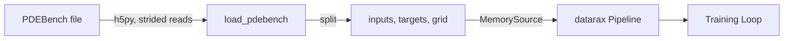

# PDEBench Dataset Loading

| Metadata | Value |
|----------|-------|
| **Level** | Beginner |
| **Runtime** | ~10 sec (CPU) |
| **Prerequisites** | JAX, h5py |
| **Format** | Python + Jupyter |

## Overview

[PDEBench](https://github.com/pdebench/PDEBench) provides HDF5-formatted
simulation trajectories across 1D/2D/3D PDEs (Burgers, Navier-Stokes, Darcy Flow,
advection, etc.). Opifex reads a PDEBench file as PDEBench's own loader does
(`FNODatasetSingle` in `pdebench/models/fno/utils.py`): every field becomes `[N, x..., t, V]`,
the test split is the first `test_ratio` of the samples, and a record is the first
`initial_step` steps of a trajectory (the input) with the whole trajectory (the target).
`load_pdebench` returns one split's arrays and `create_pdebench_loader` serves them through a
datarax `Pipeline`.

## What You'll Learn

1. **Create** synthetic HDF5 data in PDEBench's 1D Burgers layout
2. **Load** the train and test splits with `load_pdebench`
3. **Batch** records through a datarax `Pipeline` with `create_pdebench_loader`
4. **Normalize** with statistics fitted on the train split only

## Files

- **Python Script**: [`examples/data/pdebench_loading.py`](https://github.com/avitai/opifex/blob/main/examples/data/pdebench_loading.py)
- **Jupyter Notebook**: [`examples/data/pdebench_loading.ipynb`](https://github.com/avitai/opifex/blob/main/examples/data/pdebench_loading.ipynb)

## Quick Start

```bash
source activate.sh && uv run python examples/data/pdebench_loading.py
```

## Core Concepts

### PDEBench HDF5 layouts

| File | Datasets | Read as |
|------|----------|---------|
| Scalar `.hdf5` (Burgers, advection, 1D reaction-diffusion) | `tensor` `(N, T, x...)`, `x-coordinate`, `t-coordinate` (`T + 1`) | `[N, x..., T, 1]` |
| Darcy flow `.hdf5` | `nu` `(N, X, Y)`, `tensor` `(N, 1, X, Y)` | `[N, X, Y, 2, 1]`: `nu`, then the solution |
| Compressible flow `.hdf5` | `density`, `pressure`, `Vx`[, `Vy`, `Vz`] `(N, T, x...)` | `[N, x..., T, V]` in that channel order |
| Grouped `.h5` (shallow water, 2D reaction-diffusion, diffusion-sorption) | one group per sample: `data` `(T, x..., V)`, `grid/{x, y, t}` | `[N, x..., T, V]` |

### Splits and strides

`reduced_batch`, `reduced_resolution_t` and `reduced_resolution` stride the sample, time and space
axes as the file is read (only the selected rows and points are read). `num_samples_max` caps the
strided samples, the first `int(n * test_ratio)` of them are the test split and the rest the
train split. Darcy flow holds two "time" steps (`nu`, then the solution), so it takes
`initial_step=1`; an `initial_step` that leaves no step to predict is refused.

### Architecture Flow



## Code Walkthrough

### Loading a split

```python
from pathlib import Path

from opifex.data.sources.pdebench import PDEBenchConfig, create_pdebench_loader, load_pdebench

config = PDEBenchConfig(file_path=Path("data/1D_Burgers_Sols_Nu1.0.hdf5"), split="train")
train = load_pdebench(config)   # inputs (n, 1024, 10, 1), targets (n, 1024, 201, 1)
loader = create_pdebench_loader(config, batch_size=32, seed=0)
```

### Normalizing with train statistics

```python
import jax.numpy as jnp

from opifex.core.normalization import GaussianNormalizer

normalizer = GaussianNormalizer.fit(jnp.asarray(train.targets))
test = load_pdebench(PDEBenchConfig(file_path=config.file_path, split="test"))
test_targets = normalizer.normalize(jnp.asarray(test.targets))
```

## Expected Output

```
========================================================================
Opifex Example: PDEBench loading
========================================================================
JAX backend: cpu
Created synthetic HDF5: /tmp/.../1D_Burgers_synth.hdf5
  tensor shape:       (20, 20, 64)
  x-coordinate shape: (64,)
  t-coordinate shape: (21,)

Train: inputs (18, 64, 10, 1), targets (18, 64, 20, 1)
Test:  inputs (2, 64, 10, 1), targets (2, 64, 20, 1)
Grid:  (64, 1)

Pipeline batch: input (4, 64, 10, 1), target (4, 64, 20, 1)
Test targets with train statistics: mean 0.0000, std 0.8377
========================================================================
train_samples: 18
test_samples: 2
batch_size: 4
test_mean_with_train_statistics: 0.0
test_std_with_train_statistics: 0.837654709815979
```

## Next Steps

- Download real PDEBench data from [PDEBench](https://github.com/pdebench/PDEBench)
- Train an FNO on the loaded data — see [FNO Darcy](../neural-operators/fno-darcy.md)
- See [Darcy Flow Analysis](darcy-flow-analysis.md) for a related data example
